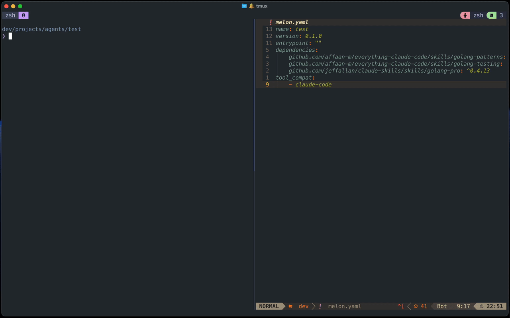

<p align="center">
  
</p>

<h1 align="center">melon</h1>

<p align="center">
  A dependency manager for agent skills — versioned, resolved, and installed for your agent harnesses.
</p>

<p align="center">
  <a href="#installation">Installation</a> ·
  <a href="#quick-start">Quick Start</a> ·
  <a href="#why-melon">Why melon?</a> ·
  <a href="#how-it-works">How it works</a> ·
  <a href="#manifest-reference">Manifest Reference</a> ·
  <a href="#commands">Commands</a> ·
  <a href="#organization-setup">Organization Setup</a>
</p>

<p align="center">
  <a href="https://github.com/playsthisgame/melon/actions/workflows/release.yml"></a>
  <a href="https://www.npmjs.com/package/@playsthisgame/melon"></a>
  <a href="https://www.npmjs.com/package/@playsthisgame/melon"></a>
  <a href="https://pkg.go.dev/github.com/playsthisgame/melon"></a>
  <a href="LICENSE"></a>
</p>

---

## What is melon?

Melon manages markdown-based packages that agent harnesses read as context. It resolves dependencies from GitHub, fetches them into a local cache, and places them into your agent's expected directory (e.g. `.claude/skills/`) so they are available immediately.

## See it in action



## Installation

**📦 Global install**

```sh
npm install -g @playsthisgame/melon
```

**🐹 Go**

```sh
go install github.com/playsthisgame/melon/cmd/melon@latest
```

Requires Git to be available on your `PATH`.

## Quick Start

**1. Initialize a project**

```sh
melon init
```

This creates a `melon.yaml` manifest and the `.melon/` cache directory. You'll be prompted for a package name, type, and which harnesses you use.

**2. Add a dependency**

Edit `melon.yaml` directly:

```yaml
dependencies:
  github.com/playsthisgame/melon-index/skills/video-to-gif: "^1.0.2"
  github.com/anthropics/skills/skills/skill-creator: "main"
```

Dependency names are GitHub paths. You can use:
- A full repo: `github.com/owner/repo`
- A monorepo subdirectory: `github.com/owner/repo/path/to/skill`
- A GitHub web URL: `github.com/owner/repo/tree/main/path/to/skill` (the `tree/<branch>/` is stripped automatically)

Versions can be a semver constraint (`^1.2.0`, `~2.0.0`, `1.0.0`) or a branch name (`"main"`).

**3. Install**

```sh
melon install
```

Melon resolves each dependency, fetches it via sparse git checkout, writes `melon.lock`, and places skills into your harness directories.

```
  resolving github.com/playsthisgame/melon-index/skills/video-to-gif (^1.0.2)...
  fetching github.com/playsthisgame/melon-index/skills/video-to-gif@1.0.2...
  + github.com/playsthisgame/melon-index/skills/video-to-gif@1.0.2
  linked github.com/playsthisgame/melon-index/skills/video-to-gif -> .claude/playsthisgame/video-to-gif
```

## How it works

```
melon.yaml          — declares your dependencies and target harnesses   ← commit
melon.lock         — pins exact versions, git tags, and content hashes ← commit
.melon/            — local cache; one directory per dep@version
.claude/skills/    — symlinks into .melon/ created by melon install
```

Skills are fetched once into `.melon/` and symlinked into the configured harness directories.

### Vendoring vs. gitignore management

By default (`vendor: true`, the implicit setting), `.melon/` and the generated symlinks are committed to your repo, so anyone who clones gets the skills without running `melon install`. If you prefer to keep deps out of git, set `vendor: false` in `melon.yaml` (or opt out during `melon init`). Melon will automatically maintain a `.gitignore` block for `.melon/` and all managed symlink paths, keeping it in sync as you add or remove dependencies.

## Manifest Reference

```yaml
# melon.yaml

name: my-agent
version: 0.1.0

description: "My coding agent"

dependencies:
  github.com/anthropics/skills/skills/skill-creator: "main"
  github.com/playsthisgame/melon-index/skills/video-to-gif: "^1.0.2"

# harnesses drives where melon install places skills.
# Melon knows the conventions for each harness automatically:
#   claude-code    -> .claude/skills/
#   cursor         -> .agents/skills/
#   windsurf       -> .windsurf/skills/
#   roo            -> .roo/skills/
#   ... (and more)
harnesses:
  - claude-code

# outputs is optional. Use it to override the automatic placement paths.
# outputs:
#   .claude/skills/: "*"

# vendor controls whether melon manages .gitignore for its cache and symlinks.
# true (default): .melon/ and skill symlinks are committed to your repo.
# false: melon auto-manages .gitignore; add/remove keeps it in sync.
# vendor: false

# index is optional. Use it to point melon search/info at private registries.
# Melon supports GitHub paths and web URLs:
#   - github.com/owner/repo/path/to/index.yaml
#   - github.com/owner/repo/tree/main/path/to/index.yaml
#   - https://raw.githubusercontent.com/owner/repo/main/path/to/index.yaml
# index:
#   urls:
#     - github.com/my-company/skill-registry/index.yaml
#     - https://example.com/index.yaml
#   public_index: true  # false = suppress the default public melon index, default is true

# policy is optional. Use it to restrict which sources can be installed.
# Patterns use glob syntax; a trailing * matches any suffix.
# policy:
#   allowed_sources:
#     - github.com/my-company/*       # any repo under this org
#     - github.com/trusted-partner/*  # another approved org

tags: []
```

### Supported harnesses

| Harness | Project skills directory | Global skills directory |
|---|---|---|
| `claude-code` | `.claude/skills/` | `~/.claude/skills/` |
| `cursor` | `.agents/skills/` | `~/.cursor/skills/` |
| `windsurf` | `.windsurf/skills/` | `~/.codeium/windsurf/skills/` |
| `roo` | `.roo/skills/` | `~/.roo/skills/` |
| `codex` | `.agents/skills/` | `~/.codex/skills/` |
| `opencode` | `.agents/skills/` | `~/.config/opencode/skills/` |
| `gemini-cli` | `.agents/skills/` | `~/.gemini/skills/` |
| `github-copilot` | `.agents/skills/` | `~/.copilot/skills/` |
| `cline` | `.agents/skills/` | `~/.agents/skills/` |
| `amp` | `.agents/skills/` | `~/.config/agents/skills/` |

> **Renamed in v0.5.0:** `harnesses` was previously called `tool_compat`. Older
> manifests keep working — melon reads `tool_compat` whenever `harnesses` is
> absent, and prints a one-line notice on install. If both keys are present,
> `harnesses` wins. Melon never rewrites the key for you.

## Skill packs

A **pack** is a curated group of skills that installs with a single `melon add`. For example, a `spring-expert` might bring in every skill you need to build a Spring application. Anyone can publish a pack: it is just a `melon.yaml` with `type: pack` whose `dependencies` are the member skills.

```yaml
# github.com/playsthisgame/melon-index/packs/spring-expert/melon.yaml (excerpt)
name: spring-expert
version: 1.1.0
description: "Build Spring Boot applications: project setup, idiomatic Spring, JUnit testing, ..."
type: pack
entrypoint: SKILL.md
dependencies:
  github.com/github/awesome-copilot/skills/java-springboot: "main"
  github.com/github/awesome-copilot/skills/java-junit: "main"
  github.com/jeffallan/claude-skills/skills/spring-boot-engineer: "^0.4.20"
  github.com/jeffallan/claude-skills/skills/java-architect: "^0.4.20"
```

Official packs live in [playsthisgame/melon-index](https://github.com/playsthisgame/melon-index#packs), and `melon search` labels them `[pack]`.

```sh
melon add github.com/playsthisgame/melon-index/packs/spring-expert
```

`melon add` lists the pack's members before installing and asks for confirmation in a terminal (pass `--yes` / `-y` to skip the prompt). Every member is resolved, fetched, locked, and placed like any other skill.

**Pure vs. hybrid packs.** A pack directory that contains only `melon.yaml` is a *pure* pack: its members are placed, the pack itself is not. If the pack directory also contains its entrypoint (`SKILL.md` by default), it is a *hybrid* pack and is placed as a skill too. This is useful for an "expert" skill that knows when to use each member.

**Use ranges, not exact pins.** If your project also depends on a pack member directly, your constraint wins as long as the pack's constraint still allows that version; otherwise install fails with a conflict naming the pack. Exact pins in packs (`"1.4.0"`) make conflicts much more likely, so `melon install` warns about them.

**Removing.** `melon remove <pack>` removes the pack and every member that nothing else requires. Members that are also direct dependencies, or that another pack requires, are kept. You cannot `melon remove` a skill that is only installed through a pack; remove the pack instead.

Packs can depend on other packs. To publish one in an index, add `type: pack` to its index entry so `melon search` labels it `[pack]`.

## Global skills

Install a skill once and every session of your harness can use it, in any project. Pass `--global` (`-g`) to any command to work on the global install instead of the current project:

```sh
melon init --global           # choose the harnesses that get global skills
melon add -g github.com/anthropics/skills/skills/skill-creator
melon list -g
melon remove -g skill-creator
```

| | Project | Global |
|---|---|---|
| Manifest and lock | `./melon.yaml`, `./melon.lock` | `~/.config/melon/melon.yaml`, `~/.config/melon/melon.lock` |
| Cache | `./.melon/` | `~/.melon/store/` |
| Placement | each harness's project directory | each harness's global directory (see the table above) |

- `melon init --global` writes the global manifest with the `harnesses` list that every global skill is placed for. Other `--global` commands ask you to run it first.
- If a harness's global directory already holds a skill with the same name that melon didn't create, melon leaves it alone and lists every skipped skill when the install finishes. `melon remove -g` and `melon clean -g` only ever delete links melon made.
- `policy.allowed_sources` in the global manifest is enforced as usual. Global installs never touch `.gitignore`.
- When you install from `melon search`, melon asks whether to install globally.

## Commands

### `melon init`

Scaffold a new `melon.yaml` and create the `.melon/` store directory.

```sh
melon init
melon init --yes        # accept all defaults (for scripting)
melon init --dir ./app  # initialize in a different directory
```

### `melon install`

Resolve dependencies, fetch them into `.melon/`, write `melon.lock`, and symlink skills into harness directories.

```sh
melon install
melon install --frozen    # fail if melon.lock would change (useful in CI)
melon install --no-place  # fetch and lock only; skip placement into agent dirs
```

If a `policy.allowed_sources` block is configured in `melon.yaml`, `melon install` validates all dependencies (including pack members and other transitive dependencies) against the allowlist before fetching any skill. Any blocked dependency causes a non-zero exit listing all violations, along with the pack or dependency that pulled each one in.

### `melon add`

Add a dependency to `melon.yaml` and run install. If no version is specified, the latest semver tag is resolved automatically.

```sh
melon add github.com/playsthisgame/melon-index/skills/video-to-gif          # resolves latest tag → ^1.2.0
melon add github.com/playsthisgame/melon-index/skills/video-to-gif@^1.0.0   # explicit constraint
melon add github.com/playsthisgame/melon-index/skills/video-to-gif@main     # branch pin
```

If a `policy.allowed_sources` block is configured, `melon add` checks the dependency source before writing to `melon.yaml` and exits with an error if the source is not permitted. For a [pack](#skill-packs), every member is checked as well.

Adding a [pack](#skill-packs) lists its members and asks for confirmation in a terminal:

```sh
melon add github.com/playsthisgame/melon-index/packs/spring-expert       # shows members, prompts [Y/n]
melon add github.com/playsthisgame/melon-index/packs/spring-expert --yes # skip the prompt
```

### `melon remove`

Remove a dependency from `melon.yaml`, unlink its agent symlinks, and delete its `.melon/` cache entry.

```sh
melon remove github.com/playsthisgame/melon-index/skills/video-to-gif
```

Removing a [pack](#skill-packs) also removes every member that is no longer required by anything else.

### `melon update`

Update dependencies to the latest version satisfying their existing constraints. Without arguments, shows an interactive multi-select list (TTY only), where the first option updates all deps. With a dep name, targets that dep directly.

```sh
melon update                                                    # interactive: pick which deps to update
melon update github.com/playsthisgame/melon-index/skills/video-to-gif  # update a specific dep
```

If a newer major version exists outside your constraint, a hint is printed showing how to upgrade with `melon add`.

### `melon outdated`

Show which dependencies have newer versions available, without modifying anything. Exits with code 1 if any dep is outdated, which is useful in CI.

```sh
melon outdated
```

Output includes current locked version, latest compatible version, and absolute latest (when a newer major exists outside your constraint). Branch-pinned deps are skipped.

### `melon diff`

Show the content changes between the currently locked version of a dependency and a target version, so you can see exactly what an AI agent's context will change before you run `melon update`. By default the target is the latest version satisfying the dep's constraint; append `@<version>` or `@<branch>` to diff against a specific target.

```sh
melon diff github.com/playsthisgame/melon-index/skills/video-to-gif         # locked vs. latest compatible
melon diff github.com/playsthisgame/melon-index/skills/video-to-gif --stat  # per-file summary only
melon diff github.com/playsthisgame/melon-index/skills/video-to-gif --no-color  # disable colored output
```

**Checking against a specific version**

Append `@<version>` to compare your locked version against any published tag. This is useful for previewing a major upgrade that sits outside your current constraint:

```sh
melon diff github.com/playsthisgame/melon-index/skills/video-to-gif@2.0.0
```

**Checking a branch-pinned dependency against `main`**

When a dependency is pinned to a branch (e.g. `main`), it's locked to the exact commit SHA you installed. "Latest" is undefined for a moving branch, so `melon diff` requires an explicit target. Pass the branch name to diff your locked commit against the current branch tip:

```sh
melon diff github.com/anthropics/skills/skills/skill-creator@main
```

If `main` has advanced since you installed, you'll see a unified diff of what changed; if it hasn't moved, melon prints `No changes`.

The target version is fetched into `.melon/` if not already cached. That is the only side effect, since `melon.yaml` and `melon.lock` are never modified. Added, removed, and changed files are shown as a unified diff; binary files are reported as changed without hunks. If the two versions have identical content, melon prints `No changes`.

### `melon list`

Show installed skills and audit installation state.

```sh
melon list                # list all installed skills
melon list --pending      # show skills in melon.yaml not yet installed
melon list --check        # verify skill symlinks exist in all tool directories
melon list --pending --check  # combine both checks
```

Default output:

```text
  github.com/anthropics/skills/skills/skill-creator  main
  github.com/playsthisgame/melon-index/skills/video-to-gif   1.2.0
```

Packs are labeled `(pack)` and their members are indented beneath them:

```text
  github.com/playsthisgame/melon-index/packs/spring-expert  1.1.0  (pack)
    github.com/github/awesome-copilot/skills/java-junit  227949a7542a
    github.com/jeffallan/claude-skills/skills/spring-boot-engineer  0.4.20
  github.com/playsthisgame/melon-index/skills/video-to-gif   1.2.0
```

With `--check`:

```text
  OK       github.com/playsthisgame/melon-index/skills/video-to-gif@1.2.0   .claude/skills/video-to-gif
  MISSING  github.com/anthropics/skills/skills/skill-creator@main    .claude/skills/skill-creator
```

With `--pending`:

```text
Pending (not installed):
  github.com/owner/repo/some-new-skill
```

Use `--json` for machine-readable output. Combines with `--pending` and `--check`:

```sh
melon list --json
melon list --json --pending --check
```

```json
{
  "installed": [
    {
      "name": "github.com/playsthisgame/melon-index/skills/video-to-gif",
      "version": "1.2.0",
      "git_tag": "v1.2.0",
      "repo_url": "https://github.com/playsthisgame/melon-index",
      "subdir": "skills/video-to-gif",
      "entrypoint": "SKILL.md",
      "tree_hash": "abc123..."
    }
  ],
  "pending": ["github.com/owner/repo/some-new-skill"],
  "check": [
    { "name": "github.com/playsthisgame/melon-index/skills/video-to-gif", "path": ".claude/skills/video-to-gif", "status": "ok" }
  ]
}
```

### `melon search`

Search for skills by keyword against the [melon-index](https://github.com/playsthisgame/melon-index) curated list. In a terminal, results are shown in an interactive list: navigate with `↑↓`, press `Enter` to select, and melon will offer to run `melon add` for you.

```sh
melon search spec          # find spec-related skills
melon search git workflow  # find git workflow skills
```

Featured skills appear at the top of results. If nothing matches, melon will tell you and suggest submitting to the index.

If your project has an `index` block in `melon.yaml`, search queries your custom registry instead of (or in addition to) the public melon index. Set `public_index: false` to see only your private skills.

### `melon info`

Show metadata for a specific skill (description, author, and available versions) before installing it.

```sh
melon info github.com/playsthisgame/melon-index/skills/video-to-gif
melon info github.com/owner/repo/path/to/skill
melon info github.com/owner/repo --json   # machine-readable output
```

With `--json`:

```json
{
  "name": "github.com/owner/repo",
  "description": "Does something useful",
  "author": "owner",
  "latest_version": "v1.2.0",
  "versions": ["v1.2.0", "v1.1.0", "v1.0.0"],
  "branches": []
}
```

If the repo has no semver tags, `versions` is `[]` and `branches` lists available branches instead.

### `melon clean`

Remove cached entries in `.melon/` that are no longer referenced by `melon.lock`. Any corresponding symlinks in agent skill directories are removed as well. This reclaims disk space left behind after removing or upgrading dependencies.

```sh
melon clean
```

If `melon.lock` does not exist, the command prints a reminder to run `melon install` first and exits without modifying anything.

## Lock file

`melon.lock` is generated by `melon install` and should be committed to version control. It pins the exact version, git tag, repo URL, subdirectory, and a SHA-256 tree hash for each dependency.

```yaml
generated_at: "2025-03-31T12:00:00Z"
dependencies:
  - name: github.com/playsthisgame/melon-index/skills/video-to-gif
    version: "1.2.0"
    git_tag: v1.2.0
    repo_url: https://github.com/playsthisgame/melon-index
    subdir: "skills/video-to-gif"
    entrypoint: SKILL.md
    tree_hash: "sha256:abc123..."
    files:
      - SKILL.md
    type: skill
    direct: true
```

`type` is `skill` or `pack`. `direct: true` marks dependencies listed in your `melon.yaml`. `via` lists the packs (or other dependencies) that pulled an entry in:

```yaml
  - name: github.com/jeffallan/claude-skills/skills/spring-boot-engineer
    # ...
    type: skill
    via:
      - github.com/playsthisgame/melon-index/packs/spring-expert
```

Lock files written by older melon versions load fine and are rewritten with these fields on the next `melon install`.

Use `--frozen` in CI to ensure the lock file is always up to date:

```sh
melon install --frozen
```

## Organization Setup

Teams can use melon to control exactly which skills developers are allowed to install and to surface a curated internal registry instead of (or alongside) the public melon index. Two `melon.yaml` fields work together for this: `policy` for source restrictions and `index` for a private skill registry.

### Restricting allowed sources

Add a `policy.allowed_sources` block to `melon.yaml` to define which GitHub organizations or repos may be installed. Patterns use glob syntax; a trailing `*` matches any suffix:

```yaml
policy:
  allowed_sources:
    - github.com/my-company/*        # any repo under your org
    - github.com/trusted-partner/*   # an approved external org
```

Melon enforces the allowlist on both `melon add` and `melon install`:

- `melon add` checks the source before writing to `melon.yaml` and exits with an error if the dependency is not permitted, so blocked skills never enter the manifest.
- `melon install` validates every entry in `melon.yaml` against the allowlist before resolving, then validates the full resolved graph (pack members and other transitive dependencies) before fetching any skill. Any violation causes a non-zero exit listing all blocked dependencies.

> **Changed in v0.5.0:** earlier versions only checked dependencies listed directly in `melon.yaml`, so transitive dependencies bypassed `allowed_sources`. If an install that used to succeed is now blocked, the error shows which dependency pulled in the blocked source (`via …`). Either add an allowlist pattern for it or drop that dependency.

This means a developer cannot accidentally (or intentionally) add an unapproved skill, and CI will catch any attempts that bypass the local check.

### Private skill registry

Use the `index` block to point `melon search` and `melon info` at your own registry:

```yaml
index:
  urls:
    - github.com/my-company/skill-registry/index.yaml
  public_index: false  # show only internal skills, hide the public melon index
```

The index URL can be a GitHub path (`github.com/owner/repo/path/to/index.yaml`), a GitHub tree URL, or a raw HTTPS URL. With `public_index: false`, search results and info lookups are scoped to your internal registry, so developers see only the approved, curated list of skills without the noise of the full public index.

Set `public_index: true` (the default) if you want to layer your private registry on top of the public one, giving developers access to both.

**Private repositories.** If the registry lives in a private GitHub repository (including a GitHub Enterprise Cloud organization), set `GITHUB_TOKEN` (or `GH_TOKEN`) to a token that can read it, for example `export GITHUB_TOKEN=$(gh auth token)`. Melon sends the token only to GitHub hosts (`github.com`, `raw.githubusercontent.com`, `api.github.com`), never to other index URLs. If an index can't be loaded, `melon search` and `melon info` print a warning that names it and still show results from your other indices.

### Distributing the policy

Commit `melon.yaml`, including the `index` and `policy` blocks, to a shared project template or internal scaffolding tool. When a developer initializes a new project from that template they inherit the policy automatically, with no extra setup step.

For monorepos, place the policy in the root `melon.yaml` so every project in the tree shares the same configuration.

## Why melon?

As agent harnesses become more capable, teams are building and sharing libraries of skills. Without a proper dependency manager, keeping these skills consistent across developers, environments, and CI becomes a manual, error-prone process.

| | Skills | Commands | Lock file | Transitive deps | Multi-harness |
|---|:---:|:---:|:---:|:---:|:---:|
| **melon** | ✅ | 🚧 planned | ✅ | ✅ | ✅ |
| **skills.sh** (`npx skills`) | ✅ | ❌ | ❌ | ❌ | ✅ |
| **Claude Code plugins** | ✅ | ✅ | ❌ | ⚠️ one level | ❌ Claude only |
| **Copy files by hand** | ✅ | ✅ | ❌ | ❌ | ⚠️ manual |

Melon is the only one that gives you a **committed lock file** — exact versions, git tags, and SHA-256 content hashes — so `melon install` produces the same tree on your machine, your teammate's, and in CI.

**Melon gives you a single source of truth.** Define all the skills your project needs in one `melon.yaml` file, commit it alongside your code, and every developer (and your CI pipeline) gets exactly the same set of skills with a single `melon install`.

**Skills are versioned, not just copied.** Melon pins exact versions, git tags, and SHA-256 content hashes in `melon.lock`. If a skill author publishes a breaking change, your team won't silently pick it up, you'll see the diff in the lock file and upgrade intentionally. This means you can trust that the skill running in CI today is the same one that ran last week.

**It works naturally with CI.** Run `melon install --frozen` in your pipeline to fail fast if the lock file is out of sync with the manifest. No surprises, no drift. With the default `vendor: true` setting, `.melon/` and the generated symlinks are committed to the repo so CI doesn't even need network access; everything is already there. If you prefer to keep deps out of git, set `vendor: false` and CI will fetch them fresh on each run using the pinned versions in `melon.lock`.

**Works across your whole team and every harness.** List the harnesses your project uses under `harnesses` and melon places each skill into every one's expected directory at once. One manifest, one install command, every harness ready to go.

## Why melon instead of npx skill installers?

Many agent skill collections ship a one-liner like `npx install-skill <name>` that copies files into your project. Melon takes a different approach:

| | melon | npx installers |
| --- | --- | --- |
| **Reproducibility** | `melon.lock` pins exact versions and content hashes | Each run may fetch a different version |
| **Transitive deps** | Resolves the full dependency graph | Usually single-package only |
| **Multiple harnesses** | `harnesses` places skills for every harness at once | Typically one target harness |
| **Offline / CI** | Already-fetched deps are cached in `.melon/` | Always fetches from the network |
| **Node.js required** | No, pure Go binary, no runtime needed | Yes |
| **Removal** | `melon remove` unlinks symlinks and purges the cache | Usually manual |

## License

[MIT](LICENSE)
